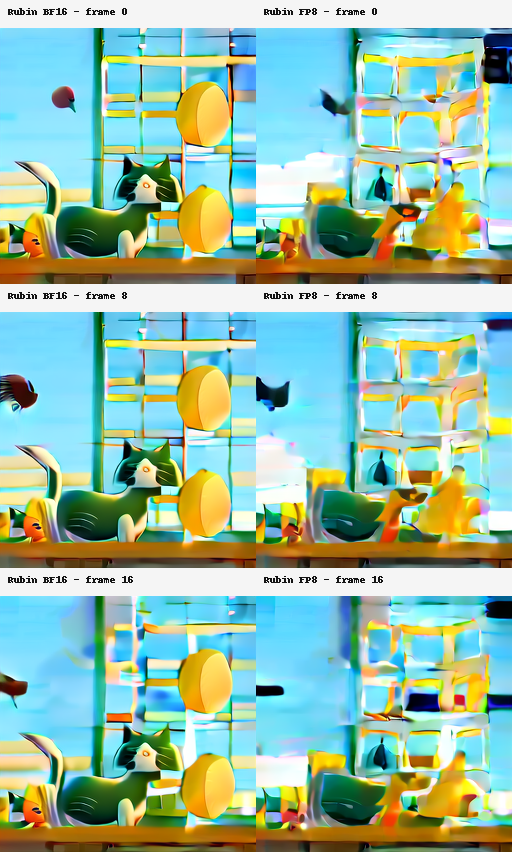
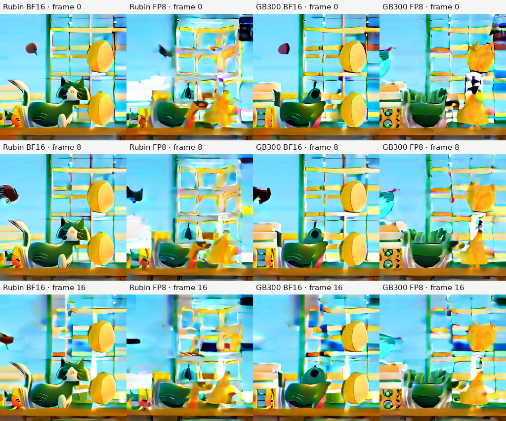

<!-- SPDX-FileCopyrightText: Copyright (c) 2026 NVIDIA CORPORATION & AFFILIATES. All rights reserved. -->
<!-- SPDX-License-Identifier: Apache-2.0 -->

# SageAttention FP8 quality study — PR 21499

The Rubin FP8 recipe `(1,16,1)` measured **mean LPIPS-alex 0.369181 against BF16**, exceeding the pre-set **<0.05** study check. The generated clips visibly differ. Kernel-level accuracy passed, while this video-quality check failed. The GB300 and repeat controls are reported below.

| Comparison | Mean LPIPS-alex | Study check | Result |
|---|---:|---:|---|
| Rubin FP8 vs Rubin BF16 | 0.369181 | <0.05 | Fail |
| GB300 FP8 vs GB300 BF16 | 0.319705 | <0.05 | Fail |
| Rubin FP8 vs GB300 FP8 | 0.360484 | <0.05 | Fail |
| Rubin BF16 vs GB300 BF16 | 0.196077 | <0.05 | Fail |
| GB300 BF16 repeat, same seed | 0.000000 | <0.05 | Pass |

The <0.05 check was fixed before generation using the existing Wan feature-quality threshold as a conservative comparison. The VisualGen team still needs to review and approve an acceptance bar for this lossy Sage FP8 recipe. This report retains failed measurements without changing that check.

Model: `Wan-AI/Wan2.1-T2V-1.3B-Diffusers`. Prompt: **A cat sitting on a sunny windowsill watching birds outside.** Both modes use 256×256 pixels, 17 frames, 20 denoising steps, guidance scale 5.0, seed 42, 16 fps, and the TRTLLM attention backend. The FP8 recipe has Q/V block size 1, K block size 16, and both smoothing options disabled. Compilation uses the unchanged defaults, with startup warmup skipped.

The study uses one short clip at reduced resolution. It establishes the observed result for this setup; broader model and prompt quality remains unmeasured. Load/compile times differ between runs, so no performance speedup is inferred.

[Rubin BF16 reference video](rubin-bf16.mp4) · [Rubin FP8 generated video](rubin-fp8.mp4)

[GB300 BF16 reference video](gb300-bf16.mp4) · [GB300 FP8 generated video](gb300-fp8.mp4) · [GB300 BF16 repeat control](gb300-bf16-repeat.mp4)

Runtime observations confirmed 30 attention instances with BF16 inputs in each mode. The reference instances carried no quantization recipe; the FP8 instances carried `(fp8, fp8, 1,16,1)`. The generator checks finite, nonconstant, 17-frame output. LPIPS uses the decoded MP4 RGB frames, normalized to [-1,1], with the pretrained AlexNet LPIPS model; scores average all 17 frames. The image above shows corresponding uncompressed RGB tensor frames.

The native source was freshly built for SM107 from runtime revision [`0b39647f`](https://github.com/daichu-nv/TensorRT-LLM/commit/0b39647f4418c132e553903ce1fc9c80d063acac). The later `708f57bf` change only documents runtime shape restrictions. Source verification checked 20,183 Git tree entries and 9,874 native LFS assets before applying the reviewed Python overlay. Fresh Rubin validation: 1,297 kernel tests passed, 1,296 unsupported INT8 cases skipped, minimum FP8 cosine 0.999919; 142 configuration tests, 148 schema tests, and eight supported quick-performance tests passed. Telemetry manifest regeneration produced no changes.

Full configuration and per-frame measurements: [BF16 args](bf16-args.json), [FP8 args](fp8-args.json), [generation parameters](generation-params.json), [metrics](metrics.json). A native probe also confirmed that FP8 at head dimension 72 is rejected before unfused fallback; the tested model uses head dimension 128.

The GB300 source was freshly built for SM103 from the same runtime revision and reviewed overlay. The repeated GB300 BF16 output is byte-identical at the tensor level. The matched FP8 outputs across SM107 and SM103 also fail the pre-set cross-device comparison check for this clip. The cross-device BF16 result also exceeds the check, so this study does not isolate the observed differences to Rubin FP8. Quality acceptance remains a separate review decision; no failed result is relabeled as passing.

Fresh GB300 validation: 1,297 kernel tests passed (1,296 unsupported INT8 cases skipped), with minimum FP8 cosine 0.999919. The same 142 configuration, 148 schema, and eight supported quick-performance cases passed; 12 unsupported INT8 performance cases skipped. All three regenerated serving schemas match the committed files. The initial GB300 attempt completed its build but stopped at the GPU-visibility check before tests; the retry explicitly selected the allocated GB300 and verified one visible SM103 device. Both architectures completed generation, and the quality phases exited nonzero on the checks shown above. Full multi-GPU PR CI remains pending its approval label.
